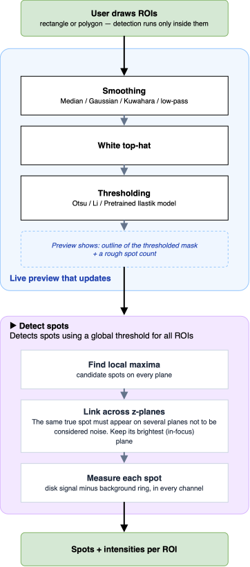
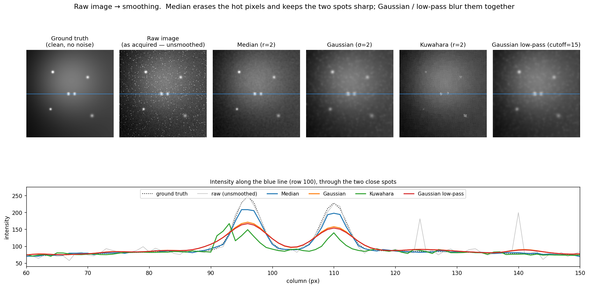
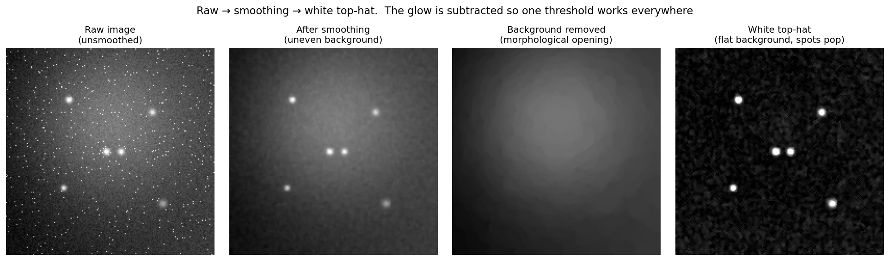
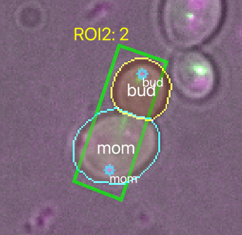

# Spot Quant — interactive fluorescent spot quantification

A napari GUI for detecting and measuring fluorescent spots in
microscopy images (tif / tiff / nd2).

## Run

```bash
conda activate img-env
python -m spot_quant
```

The GUI is a single dock widget with two tabs: **Files & detection** (file IO
and the detection controls together) and **Measurement**.

## Mac Install

Works on Apple Silicon (M1/M2/M3) and Intel. You only do steps 1–2 once.

### 1. Install miniconda from anaconda.com

### 2. Create the environment

```bash
conda create -n img-env -c conda-forge python=3.11 \
  napari pyqt numpy pandas scikit-image scipy tifffile nd2 openpyxl
conda activate img-env
conda install -c conda-forge micro_sam
```

### 3. Run the app

```bash
conda activate img-env
cd ~/Desktop/spot-quant
python -m spot_quant
```

Change the path if your folder is elsewhere. The first time you click **Segment cells**, micro-sam downloads a
model (a few hundred MB), so that first run takes a minute.

## Panels

**File IO**
- *Select folder…* lists every `.tif`, `.tiff` and `.nd2` file in a folder.
- Double-click a file to open it.
- Draw the regions of interest (ROIs) around the spots you want measured.
  Detection and measurement happen **only inside these ROIs**.
- *Import ROIs / session…* reloads the ROIs, settings and mom/bud cells from a
  previous export, so you can pick a session back up where you left it.

## Pipeline

Draw ROIs, tune smoothing → white top-hat → thresholding on a live single-plane
preview, then press **Detect spots** to detect all spots (find maxima → link
across z → measure in every channel).

<p align="center">
  
</p>

### Drawing ROIs

Detection only happens inside an ROI, so nothing is measured until you draw one.

- **Draw ROI(s)** — upright rectangles.
- **Draw polygon ROI** — any shape, for an ROI that isn't a box.
- **Tilted boxes** — draw a rectangle, switch to **Select / delete ROI**, then
  turn it with the rotation handle. It stays a true rectangle and is measured on
  its real tilted outline, not on the upright box around it. A box dragged out of
  square still works, but is flagged *not square* in case that wasn't intended.

ROI numbers are session-wide: they keep counting up across files and never
repeat, so `ROI17` means the same region in the table as it does on screen.

### Smoothing

Runs first, to stop random noise and hot pixels being read as spots. You pick the
method and size; the preview updates live.

- **Median** (default) — removes hot pixels and outliers, keeps spots sharp.
- **Gaussian** — smooths gentle noise, but blurs spots and only smears hot pixels.
- **Kuwahara** — preserves edges, but can look blocky and lower peak brightness.
- **Gaussian low-pass** — very smooth, but softens spots.



### White top-hat

Subtracts the uneven background glow, leaving spots on a flat field so one
threshold works everywhere.



### Linking across z-planes

A real spot appears on several planes as you focus through it. Linking joins its
per-plane detections into one 3-D track, keeps the brightest (in-focus) plane, and
measures there. A track seen on only one plane is treated as noise and dropped.

### Measuring a spot

Each spot is measured on a fixed-radius **disk**, with a concentric **ring**
just outside it giving the local background:

```
corrected_integrated = integrated − (ring_median × spot_pixels)
```

Signal is the thresholded pixels inside the disk; the ring excludes them.
Intensities come from the raw image — filtering decides *which* pixels count,
the raw data decides *how much* they are worth.

Two ROI-aware rules keep that honest, which matters most for small or tilted
ROIs where the upright bounding box can be twice the ROI's real area:

- A spot whose disk reaches outside its ROI's **real outline** is dropped.
- **Keep the background ring inside the ROI** (on by default) stops a spot near
  an edge reading its background from the cell next door. The `bkg_pixels`
  column reports how many pixels the median was actually taken over.

### Cells: mother / bud (optional)

Uses **micro-sam** to segment the yeast cells on the brightfield channel, so
each spot can be tagged by where it sits in a dividing cell.

<p align="center">
  
</p>

*One ROI (green, tilted to follow the spindle). The mother is outlined cyan and
the bud yellow, each labelled, with the detected spot in each.*

**Segment cells (micro-sam)** finds the cells; **Auto: all ROIs** then tags each
ROI. Fix mistakes by hand with **Pick mom** / **Pick bud**, **Remove pick**, or
by drawing a cell polygon. Needs the `micro_sam` package.

#### How a pair is chosen

Of the cells overlapping an ROI, the two with the most pixels *inside* it are
the pair — ranked by overlap, not by whole-cell area, so a large neighbour
clipping the corner can't beat the real bud. Of those two, the larger cell
overall is the mother.

**Min cell overlap (px)** sets how much of a cell must be inside the ROI to
count at all (default 50). An ROI is only scored when **both** a mother and a
bud qualify; with one cell or none, its spots get no role and `role_note` says
why.

#### How each spot is tagged

| Situation | Roles |
|---|---|
| One spot in the mother, one in the bud | `mom` and `bud` |
| Both in the mother, one clearly nearer the bud | `toward_bud` and `mom` |
| Both in the mother, neither clearly nearer | both `mom` |
| No mother-and-bud pair found | blank, with a reason in `role_note` |

"Clearly nearer" means at least **Toward-bud gap (µm)** closer to the bud
(default 0.3 µm), measured by distance transform. `dist_to_bud_um` records each
spot's distance so you can re-check the call without re-running.

## Saving and resuming

There is no separate save step — **Export XLSX…** on the Measurement tab writes
everything. It first re-runs the whole session with a single global threshold
per channel, pooled across every ROI of every file, so the numbers are
comparable across files.

`spot_measurements.xlsx` holds four sheets:

| Sheet | What it is |
|---|---|
| `measurements` | one row per spot, including `spot_role`, `dist_to_bud_um`, `pair_type`, `role_note` |
| `ROIs` | every ROI, including empty ones and polygon corners |
| `settings` | the detection parameters used |
| `cells` | the mother and bud outlines, at most two rows per ROI |

With the line-scan box ticked you also get `spot_measurements_linescans.xlsx`.

Those last three sheets make the session **re-importable**: *Import ROIs /
session…* restores your ROIs, settings and mom/bud cells — the cell outlines are
redrawn into a label image, so the cells are back on screen and usable without
re-running micro-sam.

## Tests

The pipeline, filters, line scans, session IO and cell logic are pure
numpy/pandas and run headless, with no napari or Qt needed:

```bash
conda activate img-env
pytest tests/ -v
```
